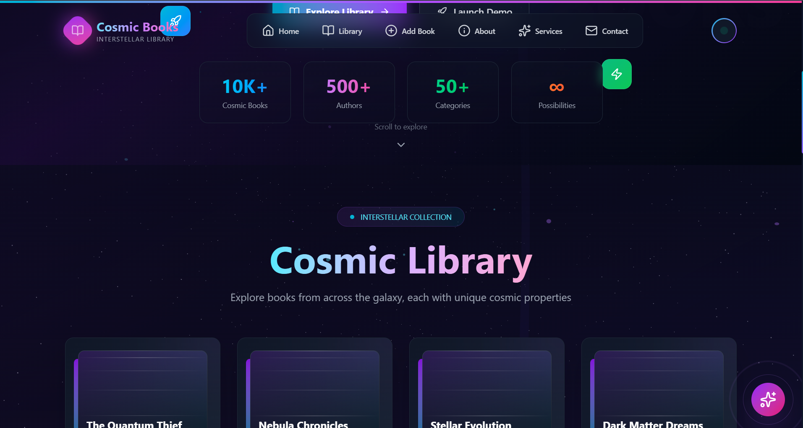

# Cosmic Books

A full-stack bookstore project exploring a visual book catalog, account workflows, and a shopping cart interface. The React frontend uses Three.js and Framer Motion for its space-inspired presentation; the Express backend connects to MongoDB.


## Project structure

- `frontend/` — React, Vite, Tailwind CSS, and interactive visuals.
- `Backend/` — Express server, database models, routes, and file upload handling.

## Run locally

Clone this repository and install Node.js and MongoDB. Configure the backend's database and environment settings locally before starting it; keep credentials outside Git.

```bash
git clone https://github.com/Zubair-zahidi/BookStore-backend-frontend.git
cd BookStore-backend-frontend/Backend
npm install
npm run dev
```

In another terminal:

```bash
cd BookStore-backend-frontend/frontend
npm install
npm run dev
```

Use the frontend URL printed by Vite. The frontend also provides `npm run build`, `npm run lint`, and `npm run preview`; the backend provides `npm start`.

## Screenshots




## Scope

This repository is a development project. Review authentication, configuration, uploads, and deployment before exposing it to real users. A cart interface does not establish a complete payment or order-processing system.

Created by **Zubair Zahidi**. For a reproducible problem, open a repository issue with the steps and expected result.
